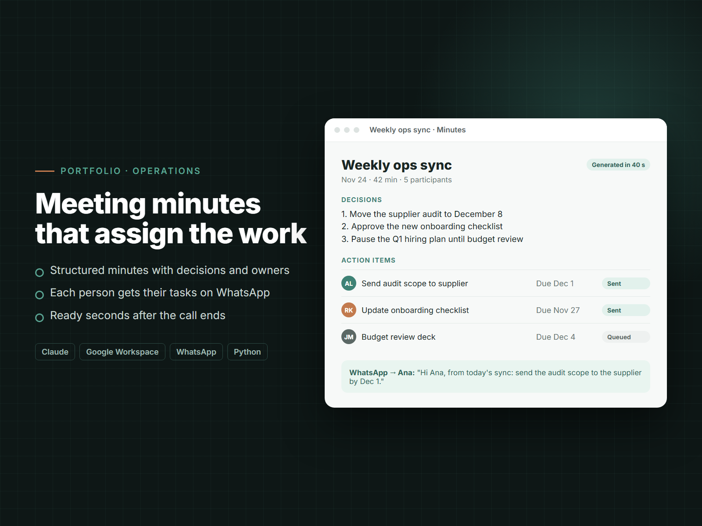
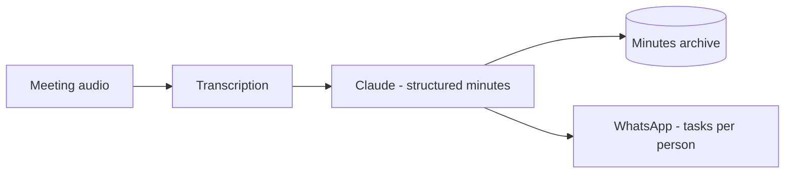

# Meeting minutes agent

> Turns a meeting into structured minutes with decisions and owners, and sends each person their tasks on WhatsApp.



## The problem

Teams left meetings with decisions nobody wrote down. Minutes took an hour to write and tasks were forgotten by the next week.

## What I built

- Transcription of online and in-person meetings
- Minutes with summary, decisions and action items (who, what, by when)
- Each participant receives only their own tasks on WhatsApp
- Minutes archived and searchable for the next meeting

## How it works



## Results

- Minutes ready seconds after the call ends
- Every action item has an owner and a date
- Less follow-up work for the meeting owner

## Stack

Claude · speech-to-text · Google Workspace · WhatsApp · Python

## A look at the approach

Illustrative example written for this page (not the production code). A strict output schema is what makes the minutes reliable enough to send tasks automatically.

```python
# Simplified: the model must return this structure, or the minutes are rejected and retried.
from pydantic import BaseModel

class ActionItem(BaseModel):
    owner: str
    task: str
    due: str | None  # ISO date, or None if nobody set one

class Minutes(BaseModel):
    summary: str
    decisions: list[str]
    action_items: list[ActionItem]
```

---

### About this repository

This is a **showcase**: it documents a system I built and run in production for a client. The source code is private
and client data is never shown. The screenshot uses sample data.

Want something like this for your business? [Hire me on Upwork](https://www.upwork.com/freelancers/mateus14).
